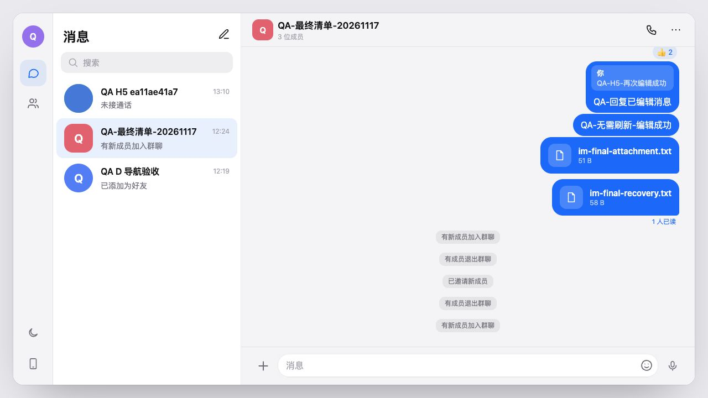
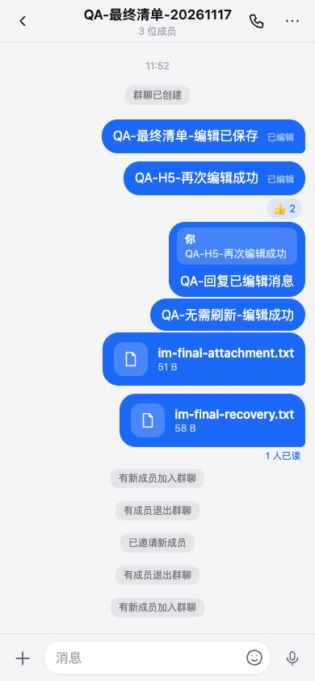

# PC 与手机 H5 固定范围对照验收 — 2026-11-17

## 结论与口径

本轮附件的30个页面基线已分别在PC 1280×720、手机H5 390×844逐页对照；320px追加窄屏检查。本轮发现的差异已修复并在浏览器复验，固定清单内没有未修复的已知差异。实际应用保留真实OpenIM功能；原型中的演示用户、固定消息及自动接听行为没有替换真实业务。

本轮只使用独立QA账号与群1699132536。没有清空、解散、删除原体验数据；临时草稿清空，QA群恢复未归档，外观恢复跟随系统。原型原文件只读。服务仍运行在 http://127.0.0.1:35881/ ，没有提交或推送代码。

## 页面基线（30 × 2）

“通过”指实际打开并对照该页面的布局、样式和可见入口；不表示每个数据组合或原生设备都逐像素检查。状态覆盖另列，避免把一个页面的通过扩张成所有状态通过。

| 序号 | 页面 | PC | 手机H5 |
| --- | --- | --- | --- |
| 1 | 消息列表 (`chats`) | 通过 | 通过 |
| 2 | 已归档会话 (`archived`) | 通过 | 通过 |
| 3 | 发起聊天 (`newChat`) | 通过 | 通过 |
| 4 | 聊天 (`chat`) | 通过 | 通过 |
| 5 | 聊天信息 (`chatInfo`) | 通过 | 通过 |
| 6 | 搜索聊天记录 (`search`) | 通过 | 通过 |
| 7 | 图片/文件/链接 (`media`) | 通过 | 通过 |
| 8 | 已读/未读成员 (`readers`) | 通过 | 通过 |
| 9 | 通话记录 (`calls`) | 通过 | 通过 |
| 10 | 通讯录 (`contacts`) | 通过 | 通过 |
| 11 | 添加好友 (`addFriend`) | 通过 | 通过 |
| 12 | 新的朋友 (`newFriends`) | 通过 | 通过 |
| 13 | 个人资料 (`profile`) | 通过 | 通过 |
| 14 | 好友更多设置 (`profileMore`) | 通过 | 通过 |
| 15 | 群列表 (`groups`) | 通过 | 通过 |
| 16 | 创建群聊 (`groupCreate`) | 通过 | 通过 |
| 17 | 加入群聊 (`groupJoin`) | 通过 | 通过 |
| 18 | 入群申请 (`groupReqs`) | 通过 | 通过 |
| 19 | 群资料 (`group`) | 通过 | 通过 |
| 20 | 群管理 (`groupManage`) | 通过 | 通过 |
| 21 | 群成员 (`members`) | 通过 | 通过 |
| 22 | 邀请成员 (`groupInvite`) | 通过 | 通过 |
| 23 | 我的 (`me`) | 通过 | 通过 |
| 24 | 编辑资料 (`editProfile`) | 通过 | 通过 |
| 25 | 通知设置 (`notify`) | 通过 | 通过 |
| 26 | 黑名单 (`blacklist`) | 通过 | 通过 |
| 27 | 账户安全 (`security`) | 通过 | 通过 |
| 28 | 登录 (`login`) | 通过 | 通过 |
| 29 | 注册 (`register`) | 通过 | 通过 |
| 30 | 重置密码 (`reset`) | 通过 | 通过 |

## 弹窗、聊天与通话状态

| 类别 | 实际浏览器核对 |
| --- | --- |
| 列表与菜单 | 新建/群菜单、归档有数据/空态、恢复归档、好友备注输入、群名称/多行公告、成员操作、外观选择；PC与手机布局核对。 |
| 确认框 | 删除好友、清空/删除会话、群主转让、解散、退出登录的确认与取消；本轮只观察并取消破坏性动作。此前独立QA真实执行结果见历史报告。 |
| 消息操作 | PC右键、H5长按菜单，回复/编辑预览及取消，转发选择页和目标确认，名片选择页，附件及表情面板。QA表情草稿插入后清空。 |
| 输入与长内容 | PC/390px三行输入展开、短句收缩、清空；320px自动换行后清空恢复；发送按钮对齐、聊天标题/文件名截断、已编辑标签不拆字。 |
| 已读 | 已读/未读页签；SDK旧历史不覆盖权威计数；真实整页刷新和导航返回后最新自发群消息仍显示1人已读。并发回执/HTTP竞争另有自动回归。 |
| 媒体汇总 | 图片/文件/链接切换与返回；独立QA群2个文件、有数据列表和空态。 |
| 通话 | 真实A→B取消；B→A来电被A拒接（两端各显示已拒接/对方已拒接）；A→B自然等待45秒超时，两端浮层关闭并显示未接通话，通话记录同步。没有接通媒体或开启摄像头。 |
| 认证 | 登录/注册/重置PC和H5视觉；PC注册滚动条修复复验，底部返回登录可用；刷新自动恢复QA会话。注册与重置业务成功由用户此前反馈正常，本轮没有再次输入新密码。 |

## 本轮修复及复验

1. 归档入口图标、64px行高、总数与桌面680px最大内容宽度：修复并在PC/H5复测。
2. 发起聊天及添加好友提示间距、通用行/Action Sheet分隔线：修复并复测。
3. 名片与转发选择页透明行底色、顶部形状、分隔线：PC/H5复测通过。
4. 注册页滚动条占位导致水平偏移：修复后PC与附件截图对照通过。
5. 发送按钮40px对齐；多行输入展开、缩回与清空：1280px、390px、320px复测通过。
6. 已编辑标签窄屏拆字：320px复测通过。
7. 已读人数被SDK旧历史覆盖：独立overlay、冷启动查询、竞态保护；刷新/返回仍显示1人已读。

已读人数独立保存在按会话/消息索引的展示缓存，不改造SDK消息字段。收到更新的回执、用户或token切换时，旧请求不能覆盖新状态；清理会话时同步清理缓存。

## 最终门禁

- UI：44 suites / 187 tests通过。
- OpenIM Node逻辑：256 tests通过。
- root与example TypeScript、root lint、git diff --check通过。
- Web导出成功：`/tmp/im-parity-final-web`。本轮不重新build SDK，避免影响运行中的Metro；本轮新增生产修改在应用层。
- 全量UI之后只有类型窄化、测试mock和格式修正；已读Hook定向UI再测4/4，Node全量再测256/256。
- 日志：`/tmp/im-delivery-final-ui.log`、`/tmp/im-delivery-final-openim.log`、`/tmp/im-delivery-final-example-ts.log`、`/tmp/im-delivery-final-lint.log`、`/tmp/im-delivery-final-web-export.log`。既有Node模块类型警告仍在，不宣称零警告。

## 保留的业务差异与范围边界

- 实际QA数据、成员数、权限、按钮校验禁用态与原型演示数据不同；保持真实后端约束。原型“自动接听”不迁入生产。
- Web使用声音控制而不假称能切换手机扬声器；原型没有定义的网络错误仍使用产品中文错误/重试提示。
- 原生Android/iOS真机和实际视频媒体按用户约定不在本轮；手机端本轮指真实浏览器390px/320px H5布局。
- 注册、重置、新密码登录已有用户正常反馈；前一轮账户安全改密的独立反馈仍待用户确认，不标成已验收。
- 真实邮件/短信投递与手机离线推送继续按已有约定排除；Explore不属于产品验收范围。

## 证据和历史索引

- [浏览器页面/状态矩阵](evidence/2026-11-17-fixed-parity/browser-matrix.json)
- [之前的真实异常与独立QA破坏性流程](../superpowers/plans/2026-11-17-live-destructive-qa.md)
- [此前逐页渲染记录](../superpowers/plans/2026-11-17-full-rendered-audit.md)

PC收尾画面：

手机H5收尾画面：

