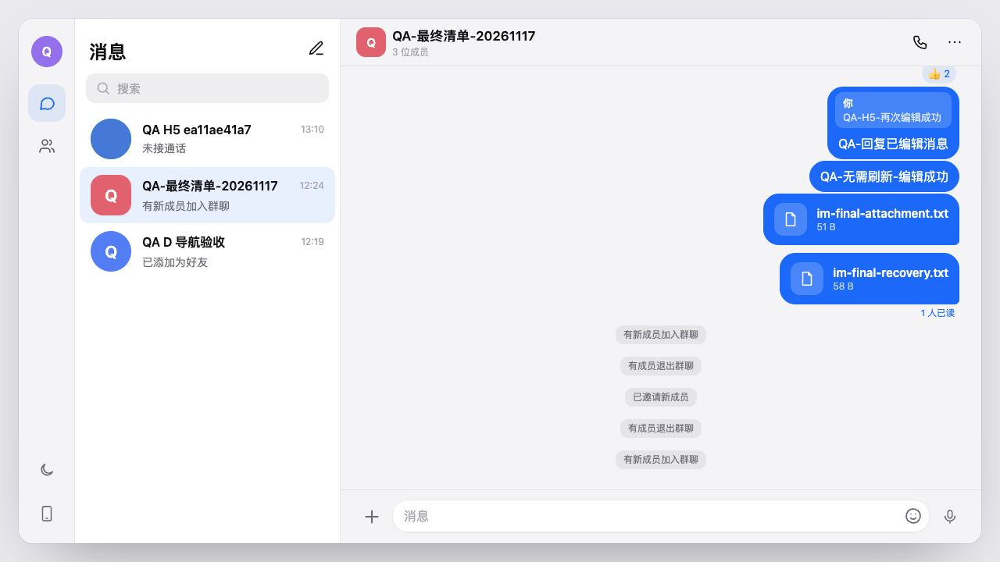

# SDK 通用扩展边界审查 — 2026-11-17

## 范围与结论

审查本地 `upstream/main`（`ee34c4164faa4c3c5c7f8f6c0996e987341bc2d9`）到当前工作区的全部 `src/` 差异，涵盖已提交改动、未提交改动及新增未跟踪测试；同时检查发布依赖和应用调用。这里是本地上游快照，不声称已联网检查最新上游。

没有发现SDK调用OpenIM接口、导入OpenIM客户端包或反向导入`example/features/im`。SDK没有产品页面、群权限判断、服务地址、QA账号或附件原型的固定配色/尺寸。当前产品颜色、尺寸、圆角、页面布局和业务判定留在应用层。

本轮发现并整理了一处职责混用：录音按钮无障碍文案原来放在`theme.voice`。现在产品通过`labels.recordAudioMessage` / `recordVideoMessage`传入；主题只继续传颜色。旧主题文案字段标记deprecated并保留兼容优先级，避免破坏已有调用。中文值、默认英文、尺寸和交互不变。

## 逐类边界

| SDK改动 | 为什么留在SDK | 应用层负责什么 |
| --- | --- | --- |
| `renderContextMenu`与Web右键开关 | 任意调用方可替换菜单；提供操作、关闭、定位和回应信息；默认菜单保留 | 产品菜单外观、操作文案、OpenIM权限和动作 |
| `actionsPosition` | 可选输入区控件排列，默认inside不变；不包含固定产品尺寸 | 是否启用leading、具体附件面板、按钮尺寸 |
| `composer.insetButtonWidth` | 通用可选主题尺寸，缺省44 | 本产品36宽的配置留在ProductChatTheme |
| `voice.idleBackground/idleIcon` | 通用主题颜色覆盖，未传时保持原有默认色 | 本产品透明背景和主题文字色 |
| 录音文案 | 改走labels；旧theme字段仅兼容，不注入中文 | ProductChatLabels中的两条中文 |
| `MessageAudio.renderPlayer` | 音频状态/控制回调与自定义外观分离，SDK继续管理播放；无renderer保留波形 | 产品语音气泡绘制 |
| `VoiceMessageInput.renderControl` | 采集、权限、时限和清理保留SDK，自定义控制只拿状态与动作 | 产品录音面板外观 |
| `MessageImage.onPressImage` | 通用图片打开回调；未传保留SDK查看器 | 产品图片预览页面 |
| picker/context-menu类型导出 | 将已有通用采集器和渲染协议公开，避免应用引用内部路径 | 附件选择后的OpenIM上传和发送 |
| 异步编辑与草稿 | 支持Promise保存、失败保留文本、受控输入恢复，适用于任意后端 | HTTP调用、编辑时限和错误提示 |
| ChatList空态与头像触摸修复 | 虚拟列表可测量host、无动作头像不截获交互 | 产品空态内容、好友资料路由 |
| Web动画、相机隔离、录音启动/取消修复 | RN/Expo平台兼容与通用生命周期问题 | 本产品启用哪些能力 |

不把“为当前项目新增”与“业务耦合”混为一谈。只要参数具有后端无关语义、默认行为保留且产品值由调用方传入，就可留在通用SDK。

## 应用层边界

- OpenIM状态、鉴权、消息发送、群权限、已读查询：`example/features/im/application/`与`infrastructure/openim/`。
- 原型样式和产品组件：`example/features/im/ui/`、各功能目录`Product*`组件。
- 中文录音文案：`example/features/im/ui/ProductChatLabels.ts`，由`ChatScreen`的`labels`属性传给SDK。
- `src/`不依赖上述目录，发布包不要求安装OpenIM客户端。

## 自动防回流

`scripts/check-sdk-boundary.cjs`解析SDK源码的静态import/export、字符串require/dynamic import、类型import；发现相对路径逃离src、应用别名`@/`或OpenIM客户端包就失败。同时检查package.json的dependencies、peerDependencies、optionalDependencies不引入OpenIM。对应Jest边界测试随全量SDK测试执行。

该检查针对静态依赖边界，不声称能自动判断所有业务语义或任意运行时拼接代码；业务判定仍需要代码审查。

## 兼容说明

旧`theme.voice.recordAudioLabel/recordVideoLabel`非nullish时继续优先，随后使用labels，最后由labels解析提供原默认英文。新代码应使用labels。SDK类型与README/llms说明同步更新。

本轮未迁入/迁出任何OpenIM接口，不改服务、账号、群或消息数据；不提交/推送。真实设备和视频不在本轮验收范围。

## 验证结果

- 新labels红态2失败/4通过，迁移后6通过；边界检查2通过。
- SDK：84套件483项测试、34快照通过；产品UI：44套件187项通过。
- 根与应用TypeScript、lint、diff检查、SDK构建、Web导出通过。
- 本地入口 http://127.0.0.1:35881/ 已恢复；PC和390px H5真实QA页面复核，录音入口中文、聊天内容和已读显示保持原状。
- 已有Node模块类型与Jest异步句柄退出提示仍在，所有命令退出0。业务逻辑没有变化，本轮没有重复整套业务/原生设备/视频验收。

